<div align="center">


# GreenMafia

**A host's companion for live games of Mafia, for 5–20 players on one phone.**

The app deals the roles, runs the night, keeps the timers, counts the votes and remembers every detail.
The host just reads the script aloud.

English · Русский · Installable PWA · Works offline · Free for noncommercial use

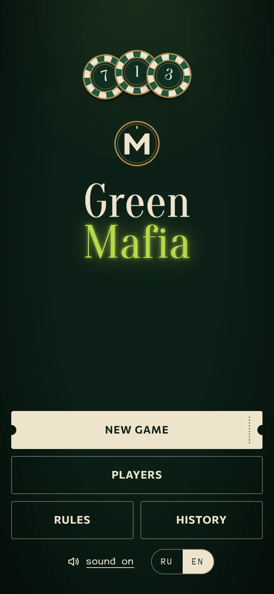
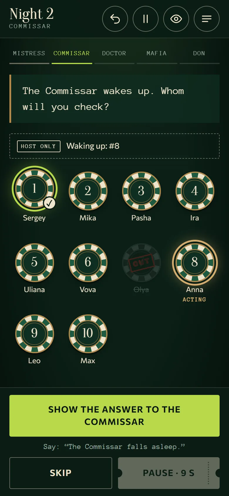
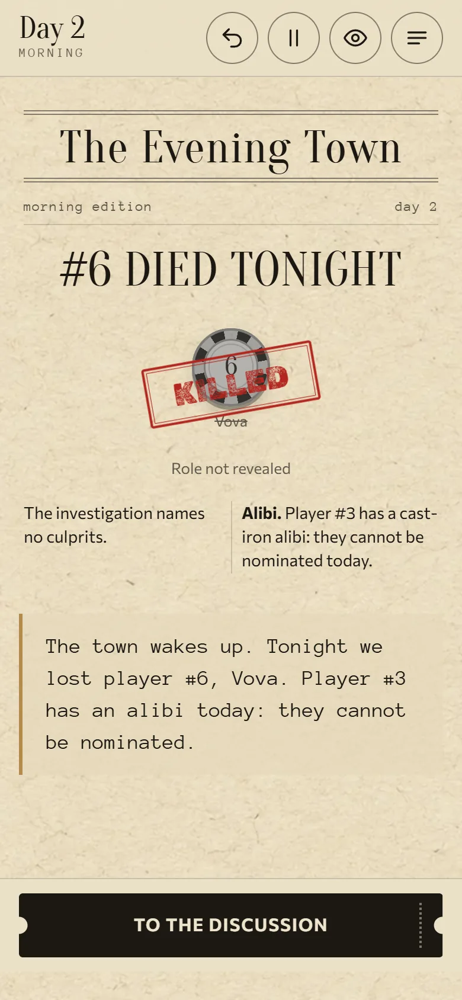

</div>

---

## Contents

- [What it is](#what-it-is)
- [Features](#features)
- [Screenshots](#screenshots)
- [Roles](#roles)
- [How a game goes](#how-a-game-goes)
- [Rules you can tune](#rules-you-can-tune)
- [Getting started](#getting-started)
- [Project structure](#project-structure)
- [Under the hood](#under-the-hood)
- [Documentation](#documentation)
- [Assets and credits](#assets-and-credits)
- [Authors](#authors)
- [License](#license)

## What it is

GreenMafia is for a group of friends playing Mafia around a real table. It is **not** an online game: everyone sits together, and one person is the host and holds the phone. The app replaces the host's notebook, cards and stopwatch:

- It **deals the roles.** The phone goes around the table and each player opens their own envelope. You can also deal physical cards and enter them.
- It **runs the night.** It wakes the roles in the right order, shows who may be chosen and why someone may not, and shows the Commissar's and the Don's answers as large, dark answer cards the host can turn towards the player. Night actions are silent, and blocked or fake wakes keep the same minimum wait.
- It **resolves the night correctly.** That covers healing, the Mistress's block and alibi, linked death, the Maniac, kills on the same target and fake wake-ups for roles that are out.
- It **runs the day.** Speeches go in seating order with a timer, then nominations, voting, ties, revotes and "everyone out" votes, defence speeches and last words.
- It **knows when the game is over.** It checks the win conditions after every night, vote and removal. At the end it reveals all roles and shows the full chronicle.
- It **remembers your club.** It keeps a player base with profiles and stats, plus a history of past games.

The whole interface is available in **English and Russian**. Pick the language on the home screen.

New installations open with a short introduction and an empty player base. The host adds local player profiles; players do not need accounts or Apple sign-in. Existing profiles and game history are preserved when updating. There is no automatic cross-device sync.

Settings on Home includes language, independent sound/vibration controls, a "Keep screen on" mode (during a game, always or never), backups, export/import, data clearing, local-storage information, GitHub support, app version and full offline license texts.

To transfer data, export a device file, move it to the other phone, then choose **Settings → Import from file**. Preview the counts before confirming. A device file replaces the current game, archive, profiles and preferences; an individual game becomes a separate copy. Files are validated locally, with a 20 MB limit. The app atomically keeps previous data and replaces the selected records, then requires a restart. Device copies from before imports/clearing history stay on that device and can be exported separately for restoration; they are not recursively included in transfer files.

Clearing history keeps a recovery copy and preserves profiles, preferences and the current game. Clearing all data requires typing the displayed confirmation word and removes all app records, including internal backups; export anything needed first. Previously downloaded files remain outside the app. Safari/iPhone file selection, saving and sharing still need device testing.

## Features

| | |
|---|---|
| 🎭 **7 roles** | Civilian, Mafia, Mafia Don, Commissar, Doctor, Mistress, Maniac |
| 👥 **5–20 players** | A recommended composition for every table size, with a balance gauge |
| 🔢 **Seat numbers 1–20** | Numbers are only labels from the table cards. The order comes from seating, so #13 may speak before #10 |
| 📜 **Host script** | Every screen shows the exact phrase to read aloud, with a typewriter effect |
| 🌙 **Correct night logic** | Wake order, blocks, healing limits, linked death, fake wake-ups with equal pauses |
| 🗳️ **Full day cycle** | Timers, nominations, alibi, voting by tapping chips or entering a number, tie rules, revotes |
| 🕹️ **Host console** | Change a seat number, fix a name, give a foul, mark a player who left, remove a player — mid-game |
| ↩️ **Undo anything** | Every action is an event, so any step can be undone |
| 💾 **Never lose a game** | The game is saved after every action and restored after a reload or a crash |
| 📇 **Player base** | Profiles, games, wins, win rate by team and role, how players went out |
| 🖨️ **Print kit** | A4 folding seat numbers 1–20 plus a one-page guide for the table, in both languages |
| 📱 **PWA** | Install it on a phone like an app. It works offline, with no app store |
| 🌍 **English & Русский** | Every text, stamp and print sheet is translated |

## Screenshots

### Setting up a game

<table>
  <tr>
    <td align="center">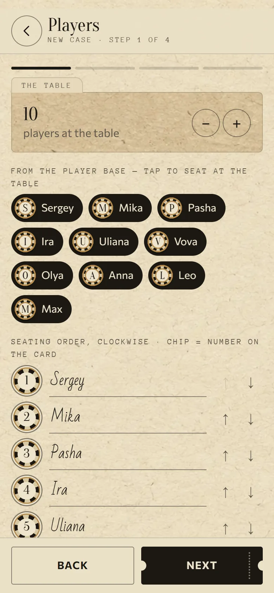<br><sub>Players come from the base. Tap a chip to pick a seat number</sub></td>
    <td align="center">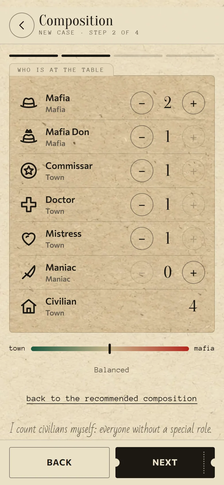<br><sub>Composition with a balance gauge. Civilians are counted automatically</sub></td>
    <td align="center">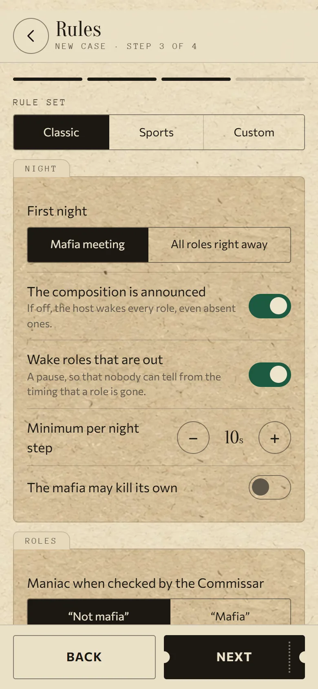<br><sub>Classic or sports rules, or tune every setting</sub></td>
  </tr>
</table>

### The deal

<table>
  <tr>
    <td align="center">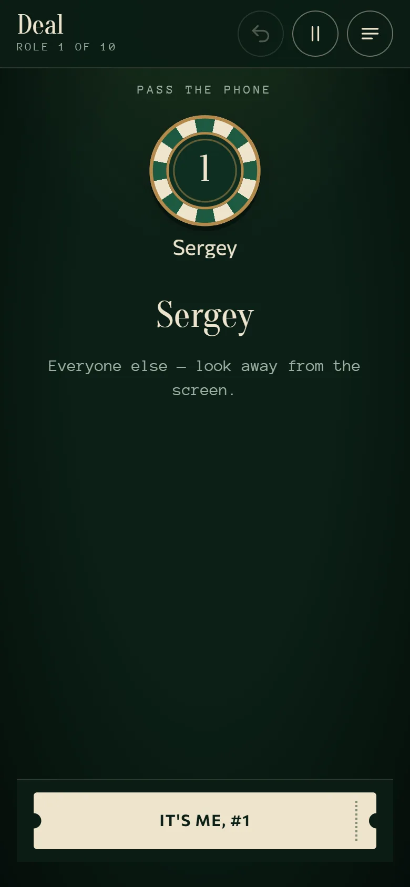<br><sub>The phone goes around the table</sub></td>
    <td align="center">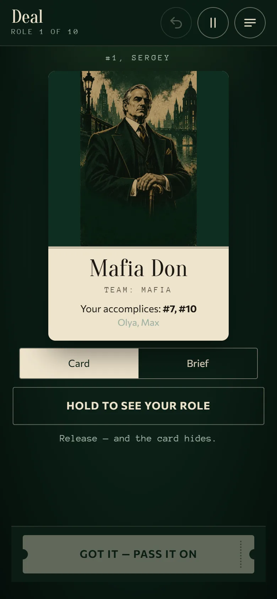<br><sub>Hold to see your role. Mafia players see their accomplices</sub></td>
    <td align="center">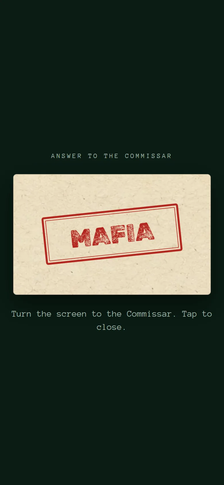<br><sub>Commissar's answer; the current design uses a dark card</sub></td>
  </tr>
</table>

### Night and day

<table>
  <tr>
    <td align="center"><br><sub>Night: the acting player is highlighted and the choice is checked against the rules</sub></td>
    <td align="center"><br><sub>Morning: the results of the night as a newspaper</sub></td>
    <td align="center">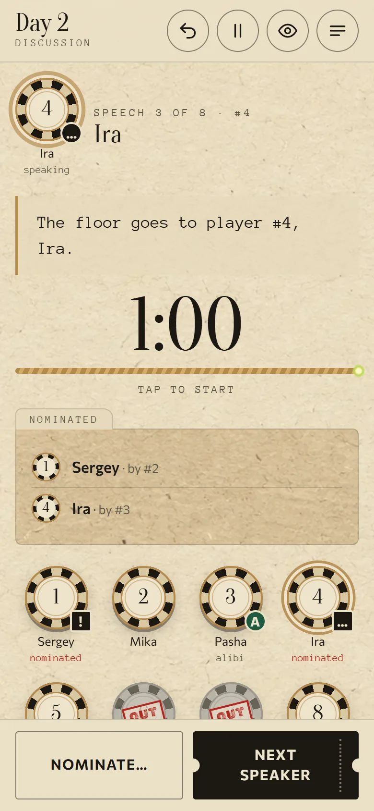<br><sub>Speeches in seating order with a timer, nominations and an alibi</sub></td>
  </tr>
  <tr>
    <td align="center">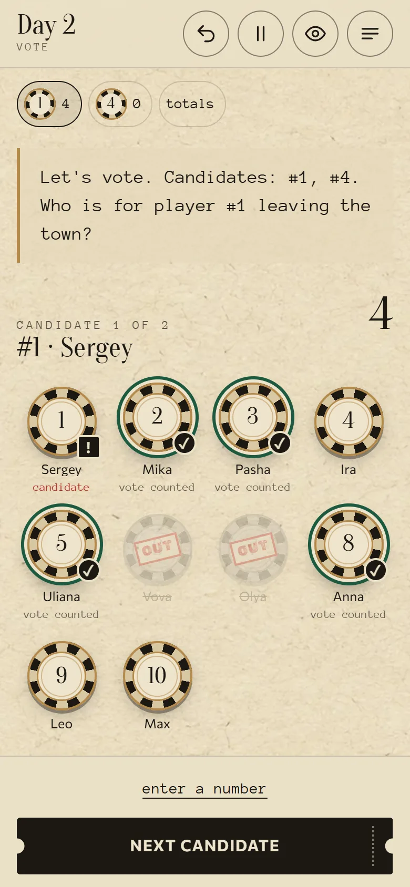<br><sub>Voting: tap the chips of the players who vote</sub></td>
    <td align="center">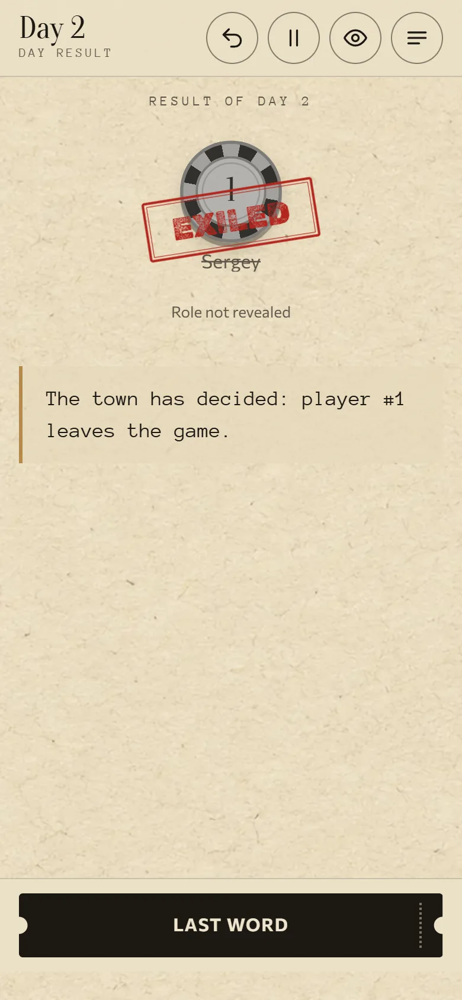<br><sub>The verdict, then the last word</sub></td>
    <td align="center">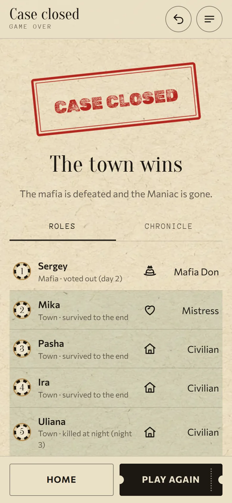<br><sub>Game over: all roles and the full chronicle</sub></td>
  </tr>
</table>

### Your club

<table>
  <tr>
    <td align="center">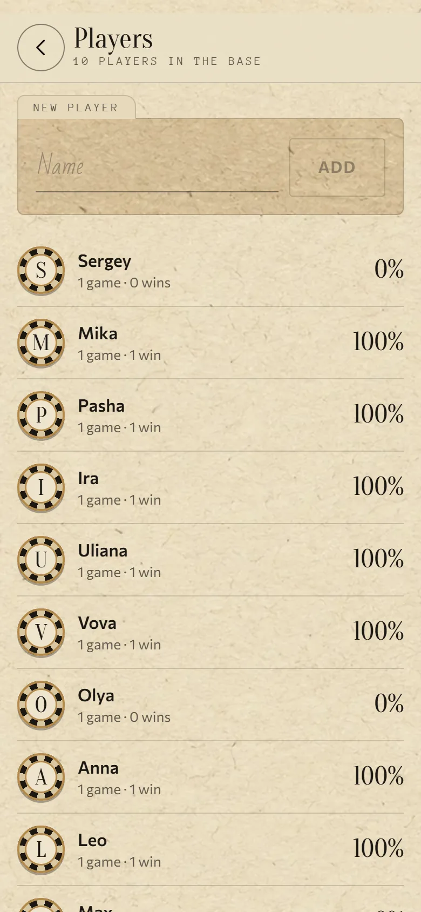<br><sub>The player base</sub></td>
    <td align="center">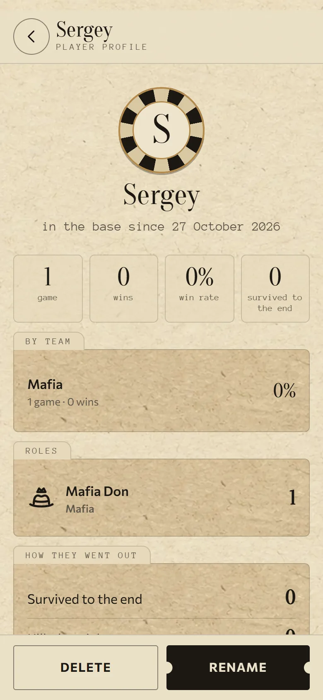<br><sub>Profile and stats</sub></td>
    <td align="center">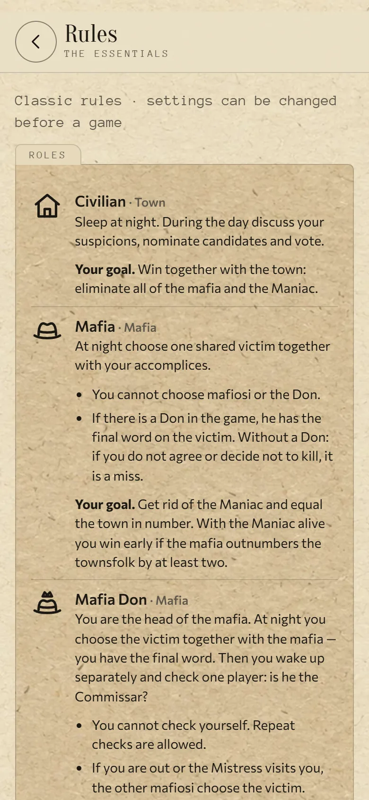<br><sub>Rules and role briefs that follow the current settings</sub></td>
  </tr>
</table>

## Roles

| Role | Team | At night | The Commissar sees |
|---|---|---|---|
| **Civilian** | Town | Sleeps | "Not mafia" |
| **Mafia** | Mafia | Chooses one victim together with the mafia | "Mafia" |
| **Mafia Don** | Mafia | Has the final word on the victim; then wakes alone and checks whether a player is the Commissar | "Mafia" |
| **Commissar** | Town | Checks one player: "Mafia" / "Not mafia" | "Not mafia" |
| **Doctor** | Town | Heals one player (not the same player twice in a row; himself once per game) | "Not mafia" |
| **Mistress** | Town | Visits one player: the client skips their turn and gets a day alibi. If she is killed at night, her client dies with her | "Not mafia" |
| **Maniac** | Alone | Kills one player | "Not mafia" (configurable) |

**Night order:** Mistress → Commissar → Doctor → Mafia with the Don → Don alone → Maniac.

When the Mistress visits a role, that role gets a big cross screen instead of a choice, and its turn is skipped.

<details>
<summary><b>Recommended composition by table size</b></summary>

| Players | Mafia | Don | Commissar | Doctor | Mistress | Maniac | Civilians |
|:-:|:-:|:-:|:-:|:-:|:-:|:-:|:-:|
| 5 | 1 | – | 1 | – | – | – | 3 |
| 6 | 1 | 1 | 1 | – | – | – | 3 |
| 7 | 1 | 1 | 1 | 1 | – | – | 3 |
| 8 | 1 | 1 | 1 | 1 | – | – | 4 |
| 9 | 1 | 1 | 1 | 1 | 1 | – | 4 |
| 10 | 2 | 1 | 1 | 1 | 1 | – | 4 |
| 11 | 2 | 1 | 1 | 1 | 1 | 1 | 4 |
| 12 | 2 | 1 | 1 | 1 | 1 | 1 | 5 |
| 13 | 2 | 1 | 1 | 1 | 1 | 1 | 6 |
| 14 | 3 | 1 | 1 | 1 | 1 | 1 | 6 |
| 15 | 3 | 1 | 1 | 1 | 1 | 1 | 7 |
| 16 | 3 | 1 | 1 | 1 | 1 | 1 | 8 |
| 17 | 4 | 1 | 1 | 1 | 1 | 1 | 8 |
| 18 | 4 | 1 | 1 | 1 | 1 | 1 | 9 |
| 19 | 4 | 1 | 1 | 1 | 1 | 1 | 10 |
| 20 | 5 | 1 | 1 | 1 | 1 | 1 | 10 |

You can change any number. The app warns you if the table becomes unbalanced and blocks impossible setups.
</details>

<details>
<summary><b>Win conditions</b></summary>

Checked after every night, every vote and every removal. The first match wins.
**M** = living mafia (including the Don), **K** = 1 if the Maniac is alive, **T** = living town players.

| Condition | Result |
|---|---|
| Nobody is left | Draw |
| M = 0, K = 0 | **Town wins** |
| M = 0, K = 1, T ≤ 1 | **Maniac wins** |
| M ≥ 1, K = 0, M ≥ T | **Mafia wins** (parity) |
| M ≥ 1, K = 1, M ≥ T + 2 | **Mafia wins** (early, can be turned off) |
| M = 1, K = 1, T = 0 | Draw (early, can be turned off) |

</details>

## How a game goes

1. **Setup.** Seat the players from the base or type new names. Give each player the number from their table card. Choose the composition and the rules.
2. **Deal.** The app deals: the phone goes around and each player holds their envelope to see the role. Or you deal real cards and mark who got which role.
3. **First night.** By default the mafia only meets each other. This can be switched to a full night.
4. **Morning.** The town reads who died, with no roles revealed by default. The Mistress's client gets an alibi.
5. **Day.** Speeches go in seating order with a timer, and players are nominated (a player with an alibi cannot be). Then the vote. On a tie the candidates speak in defence and there is a revote, then an "everyone out?" vote (or a single revote, or nobody leaves — your choice). The exiled player gets a last word.
6. **Repeat** until one side wins. Then the app reveals all roles and the chronicle: every visit, check, heal, kill, nomination and vote.

The host can pause the game, undo the last step, or open the **host console** to fix a seat number or a name, give a foul (the third foul skips the next speech), mark someone who left, or remove a player. After any of these the app checks the win conditions again.

## Rules you can tune

Two presets, **Classic** and **Sports**, or your own mix. Save your own mix as a **rule profile** ("My rules" on the Rules step) and pick it with one tap next time; profiles can be renamed, updated and deleted, and they travel with device export/import:

- **Night:** first night (mafia meeting / all roles), whether the composition is announced, fake wake-ups for roles that are out, a minimum time per night step, whether the mafia may kill its own.
- **Roles:** how the Maniac looks to the Commissar, the Doctor's self-heal limit and repeat heals, the Mistress's repeat visits, alibi, night protection and linked death, whether the alibi client votes.
- **Day:** timers for speeches, defence and last words, last words for night victims, nominations, first-day voting, self-nomination, who opens the day, tie rules (defence + revote + all-out vote / one revote / nobody leaves), abstaining, how much of an eliminated player's role is revealed, fouls.
- **Announcements and wins:** announcing saves, early detection of a decided outcome.

The role briefs players see during the deal always describe the rules of *this* game.

## Getting started

Requirements: **Node.js 22** and npm (the version used in CI).

```bash
git clone https://github.com/sergeyopaic/GreenMafia.git
cd GreenMafia
npm ci
npm run dev          # http://localhost:5173
```

To open it on a phone in the same Wi-Fi, run `npm run dev -- --host` and use the network address Vite prints. Or build and serve it:

```bash
npm run build        # type-check + production build into app/dist
npm run preview --workspace app
```

Once it is opened over HTTPS, "Add to Home Screen" installs it as an app that works offline.

| Command | What it does |
|---|---|
| `npm run dev` | Dev server with hot reload |
| `npm run build` | Type-check and build the PWA |
| `npm test` | Engine and app tests (Vitest) |
| `npm run typecheck` | TypeScript in both packages |
| `npm run check` | Type-check, test both packages and build the production PWA |
| `npm run notices --workspace app` | Refresh bundled runtime/font license texts after dependency updates |
| `npm run graphics --workspace app` | Regenerate the stamps (Russian and English), card back and emblem |
| `npm run print-kit --workspace app` | Regenerate the A4 print kits (`print-kit.html`, `print-kit.en.html`) |
| `npm run sounds --workspace app` | Regenerate the procedural sound effects |

GitHub Actions runs `npm ci --no-audit --no-fund` and `npm run check` on pushes and pull requests; it can also be started manually. The workflow only verifies the project and does not publish it. App tests include storage failures, save recovery and React screen transitions in Happy DOM. These checks do not replace Safari, VoiceOver or physical iPhone testing; the remaining release checks are tracked in [TODO_RELEASE.md](TODO_RELEASE.md).

Production builds also verify that `app/src/assets/licenses/third-party.json` matches the installed dependencies. The notices include runtime libraries and fonts, offline support from Workbox, and full Apache terms alongside idb-keyval's attribution. Regenerate the notices after updating dependencies and review any license changes before releasing.

## Project structure

```
GreenMafia/
├─ GAME_DESIGN.md        # design document (Russian original)
├─ GAME_DESIGN.en.md     # design document (English translation)
├─ engine/               # the rules: pure TypeScript, no UI
│  └─ src/               # events, night & day resolution, win checks, queries
├─ app/                  # the host-mode PWA
│  ├─ src/
│  │  ├─ screens/        # setup, deal, night, morning, day, voting, game over…
│  │  ├─ components/     # chips, stamps, timer, host console, chronicle…
│  │  ├─ i18n/           # ru.ts (master) and en.ts dictionaries
│  │  ├─ lib/            # storage, player base, role briefs, assets
│  │  └─ assets/         # role art, stamps (ru + en), textures, sounds
│  ├─ public/            # icons, print kits
│  └─ scripts/           # generators for stamps, sounds, icons, print kits
└─ docs/screenshots/
```

## Under the hood

- **Event-sourced engine.** A game is a list of events (`CreateGame`, `NightChoose`, `Nominate`, `CastVotes`, `Foul`, `ChangeSeat`…). The state is always `events.reduce(apply)`. That gives undo for free, saves games completely, and makes every rule easy to test.
- **The engine refuses illegal moves.** Every rejection has a code and parameters, for example `{ code: 'night.target', reason: 'target.doctor.repeat' }`. The app turns these into a message in the player's language, and the night grid explains why a chip is disabled.
- **Tested logic.** The engine has 146 tests that cover the scenarios from the design document, including an exhaustive check that the win rules never overlap. App tests cover the player base, role briefs, assets, persistence, privacy and recovery after UI failures.
- **Recovery after UI errors.** The app hides secrets and pauses the game before showing a recovery screen. It preserves the in-memory journal so remounting the interface cannot replace it with an older autosave. The host can export a private game file or a separate technical report that excludes names, roles, event logs and raw exception text; neither is sent automatically.
- **Stack.** TypeScript, React 19, Vite 7, vite-plugin-pwa, Zustand and IndexedDB (idb-keyval), with self-hosted fonts: Oranienbaum, Commissioner, Anonymous Pro, Bad Script and Rubik Dirt.
- **Translations.** `app/src/i18n/ru.ts` is the master dictionary and `en.ts` must have exactly the same shape, so TypeScript fails the build if a string is missing. Stamps and print kits are generated per language.

## Documentation

The full rules, every edge case, the settings, the host script, the screens and the test scenarios are in the design document:

- 🇬🇧 [GAME_DESIGN.en.md](GAME_DESIGN.en.md) — English
- 🇷🇺 [GAME_DESIGN.md](GAME_DESIGN.md) — Russian (original)

## Assets and credits

- The role illustrations and paper textures were generated for this project. The prompts are in [`app/src/assets/generation-prompts.json`](app/src/assets/generation-prompts.json).
- The sound effects are original and generated procedurally by [`app/scripts/make-sounds.mjs`](app/scripts/make-sounds.mjs).
- The stamps use **Rubik Dirt** under the SIL Open Font License ([license](app/src/assets/RUBIK-DIRT-LICENSE.txt)). The other fonts come from [Fontsource](https://fontsource.org/), each under its own open license.

## Authors

- **Sergey Ivanov** — [@sergeyopaic](https://github.com/sergeyopaic)
- **Mikael Ahabalyants** — [@njxqlus](https://github.com/njxqlus)

## License

GreenMafia is **source-available** under the [PolyForm Noncommercial License 1.0.0](LICENSE.md).

- ✅ **You may** use the app for free, play it with friends or in an amateur club, study the code, change it and share your changes — for any noncommercial purpose. Schools, charities and other noncommercial organizations may use it too.
- ❌ **You may not** sell the app or a copy of it (including a paid or ad-supported version in an app store), or use the code in any commercial product or service.
- 📝 Every copy must keep the license and the `Required Notice` line with the authors' names.

Want to use GreenMafia commercially? [Open an issue](https://github.com/sergeyopaic/GreenMafia/issues) to ask the authors for a commercial license.

Copyright © 2026 Sergey Ivanov and Mikael Ahabalyants. The fonts keep their own licenses (see [Assets and credits](#assets-and-credits)).
